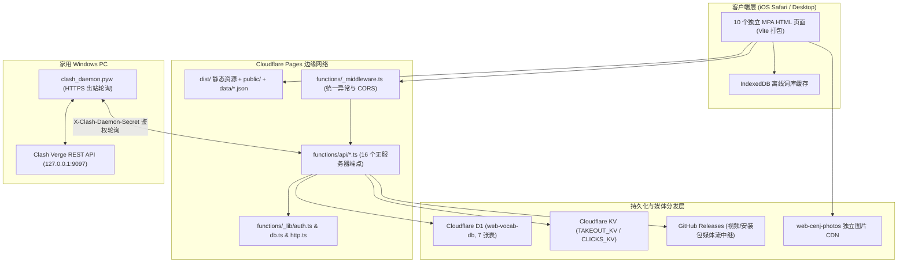

# Web-Cenj 云端数字枢纽系统全局架构与工程全景手册

> **文档版本**: v4.0.0 (Vite MPA + 全栈 TypeScript + 安全重构版)  
> **最后更新**: 2026-11-19  
> **文档定位**: 项目全局技术架构、前后端 TypeScript 模块设计、Cloudflare Pages Functions 边缘网关、D1/KV 存储字典、零硬编码安全边界与工程部署验收规范。

---

## 目录
1. [项目全景与核心使命](#1-项目全景与核心使命)
2. [总体系统架构与技术栈](#2-总体系统架构与技术栈)
3. [仓库代码全景目录树](#3-仓库代码全景目录树)
4. [10 大前端页面与模块化架构](#4-10-大前端页面与模块化架构)
5. [Cloudflare Pages Functions 后端接口全景](#5-cloudflare-pages-functions-后端接口全景)
6. [数据库表结构与存储设计 (D1 / KV / IndexedDB)](#6-数据库表结构与存储设计-d1--kv--indexeddb)
7. [安全边界与环境变量规范](#7-安全边界与环境变量规范)
8. [构建、代码质量检查与部署指南](#8-构建代码质量检查与部署指南)
9. [运维维护与故障排查速查表](#9-运维维护与故障排查速查表)

---

## 1. 项目全景与核心使命

### 1.1 项目定位
`web-cenj` 是基于 **Cloudflare Pages 全球边缘网络** 构建的多端云边协同个人数字枢纽。经过 v4.0.0 架构重构，全站由原始单文件静态脚本升级为 **Vite 多页应用（MPA）+ 前后端全栈 TypeScript + Biome 代码规范 + Vitest 单元测试** 的现代工程化架构，完整保留所有原有 `*.html` 与 `/api/*` 路由兼容，以及 `scripts/*.py` 与 `data/*.json` 数据工具链。

### 1.2 重构核心改进
1. **全栈 TypeScript 强类型契约**：前后端通过 [`shared/types.ts`](file:///home/antigravity/chn-youbai/web-cenj/shared/types.ts) 共享请求/响应与词库结构类型，开启 `strict: true` 与 `noUncheckedIndexedAccess: true`，分别由 [`tsconfig.json`](file:///home/antigravity/chn-youbai/web-cenj/tsconfig.json)（前端 + 测试）与 [`tsconfig.functions.json`](file:///home/antigravity/chn-youbai/web-cenj/tsconfig.functions.json)（Cloudflare Workers + 后端测试）独立校验。
2. **彻底清除内联脚本与硬编码密钥**：
   - 删除遗留 `css/`、`js/` 与 `functions/**/*.js` 文件，全部业务代码模块化拆分为 `src/core/*`、`src/pages/*`、`src/styles/*` 与 `functions/_lib/*`、`functions/api/*.ts`。
   - 彻底移除前端与后端源码中的所有默认/测试密码、机场 Token、共享账号密码与 Token 硬编码，全面改为 Cloudflare Pages 环境变量注入 + 常量时间比对（`safeEqual`）+ 未配置默认拒绝（Fail-Closed）。
3. **XSS 与并发安全加固**：动态 HTML 片段统一使用 [`escapeHtml`](file:///home/antigravity/chn-youbai/web-cenj/src/core/dom.ts) 进行转义；页面事件处理统一采用 `addEventListener` 与事件委托，消除内联 `onclick` 属性。
4. **自动化工程质量闭环**：集成 Biome 格式化与静态检查、TypeScript 类型检查、Vitest 单元测试与 Vite 多入口打包，通过 `npm run check` 一键门禁。

---

## 2. 总体系统架构与技术栈

| 层次 | 选型与核心工具 | 职责说明 |
| :--- | :--- | :--- |
| **前端构建** | Vite 6 MPA ([`vite.config.ts`](file:///home/antigravity/chn-youbai/web-cenj/vite.config.ts)) | 编译 10 个独立 HTML 入口并输出至 `dist/`，通过自定义插件同步 `data/*.json` 与 `/api` 本地代理 |
| **前端语言与样式** | TypeScript 5.7 + 模块化 CSS + Tailwind（工具页面按需） | `src/core/*` 提供通用网络、DOM、弹窗、存储、Toast 能力；`src/pages/*` 负责页面状态机与渲染 |
| **边缘后端** | Cloudflare Pages Functions (TypeScript) | `functions/_middleware.ts` + `functions/_lib/*` + 16 个 `/api/*` 路由 |
| **数据库与缓存** | Cloudflare D1 (`web-vocab-db`) + Cloudflare KV + 浏览器 IndexedDB | 7 张 D1 核心表 + `TAKEOUT_KV`/`CLICKS_KV` + 离线万词库 IndexedDB |
| **代码规范与测试** | Biome 1.9 + Vitest 3 (`happy-dom`) | 格式化、静态规则检查、核心纯函数/工具库自动化单元测试 |



---

## 3. 仓库代码全景目录树

```text
web-cenj/
├── index.html                    # 1. 门户首页 (个人展示、互动点赞、导航、Clash 暗号入口)
├── gallery.html                  # 2. 精彩图库与流媒体视频中心
├── upload.html                   # 3. 移动端视频云端直传页
├── pan.html                      # 4. 资源网盘与订阅下载中心
├── board.html                    # 5. 秘密留言板
├── clash.html                    # 6. Clash Verge PC 远程控台
├── showcase.html                 # 7. 在线资源与边缘探针展示馆
├── takeout.html                  # 8. 沙县外卖多人记账助手
├── recite.html                   # 9. 高考 2050 高频核心词速记卡
├── vocab.html                    # 10. 英语综合查词与词根词族系统 (11,160+ 词)
│
├── shared/
│   └── types.ts                  # 前后端共享 TypeScript 类型契约
├── src/
│   ├── core/                     # 跨页面公共基础模块
│   │   ├── api.ts                # 统一 fetch / JSON 请求与错误处理
│   │   ├── dom.ts                # escapeHtml / DOM 查询辅助
│   │   ├── modal.ts              # 通用弹窗控制器
│   │   ├── storage.ts            # localStorage / sessionStorage 安全封装
│   │   └── toast.ts              # 全局轻量提示条
│   ├── styles/                   # 各页面独立 CSS 样式 (base.css + 10 个页面样式)
│   └── pages/                    # 按页面拆分的 TypeScript 业务模块
│       ├── index/                # auth-modal, easter-eggs, likes, main
│       ├── gallery/              # lightbox, photos, videos, main
│       ├── upload/               # main
│       ├── pan/                  # bind-modal, subscription, main
│       ├── board/                # identity, messages, main
│       ├── clash/                # api, auth, renderers, main
│       ├── showcase/             # probes, main
│       ├── takeout/              # cloud-sync, menu-data, modals, render, settlement, store, types, main
│       ├── recite/               # engine, idb, phrases-dict, raw-words, render, sync, types, main
│       └── vocab/                # csv, derivatives, idb, render, search, types, word-knowledge, main
│
├── functions/
│   ├── _middleware.ts            # 全局 Pages Functions 中间件
│   ├── _lib/
│   │   ├── auth.ts               # safeEqual / 密码提取与环境变量鉴权
│   │   ├── db.ts                 # D1 表懒初始化与结构化读写辅助
│   │   ├── env.ts                # Env 绑定与环境变量类型定义
│   │   └── http.ts               # CORS / JSON / no-store / HTML 转义响应工具
│   └── api/                      # 16 个 TypeScript API 路由
│       ├── [[catchall]].ts       # 404 API 兜底
│       ├── auth.ts               # 管理员密码服务端校验
│       ├── board.ts              # 留言板 CRUD 与点赞
│       ├── clash.ts              # Clash 远程控制信令总线
│       ├── click.ts              # 门户点赞计数
│       ├── derivatives.ts        # 词根词族查询
│       ├── download.ts           # 网盘双通道直链中继
│       ├── recite-sync.ts        # 2050 词库学习状态云同步
│       ├── recite-vocab.ts       # 2050 词库数据读取
│       ├── sub.ts                # Clash 免密订阅中继 (多域名容灾)
│       ├── subscription.ts       # 机场订阅/VPN07 刷新/Apple ID 下发
│       ├── takeout.ts            # 外卖账单 KV 云同步
│       ├── upload-asset.ts       # 视频直传 GitHub Releases 中继
│       ├── video.ts              # HTTP Range 206 视频流式播放中继
│       ├── videos.ts             # 视频元数据列表与管理
│       └── vocab.ts              # 1.1 万词库查询与增量维护
│
├── public/                       # Vite 静态透传资源
│   ├── OIP-C.jpg
│   ├── left_avatar.png
│   ├── right_avatar.jpg
│   └── posters/vid_img_0802.jpg
├── data/
│   ├── schema.sql                # D1 完整 7 表建表脚本
│   ├── vocab.json                # 1.1 万离线词库
│   ├── gaokao_2050.json          # 高考 2050 词库 JSON
│   ├── root_families.json        # 词根词族关系映射
│   └── csv/                      # 原始课本 CSV 归档
├── scripts/                      # Python 数据维护与 D1 同步工具链 (保持完整兼容)
├── tests/                        # Vitest 单元测试套件
│   ├── takeout-settlement.test.ts
│   ├── vocab-search.test.ts
│   ├── recite-sync.test.ts
│   └── functions-auth-http.test.ts
├── .env.example                  # Cloudflare Pages 环境变量配置模板
├── biome.json                    # Biome 检查与格式化规则
├── package.json                  # npm scripts 与依赖清单
├── tsconfig.json                 # 前端 + 测试 TypeScript 配置
├── tsconfig.functions.json       # 边缘后端 + 后端测试 TypeScript 配置
├── vite.config.ts                # Vite MPA 构建配置
├── vitest.config.ts              # Vitest 测试配置
└── wrangler.jsonc                # Cloudflare Pages / D1 部署配置
```

---

## 4. 10 大前端页面与模块化架构

| 页面路由 | 模块目录 | 核心职责 |
| :--- | :--- | :--- |
| [`index.html`](file:///home/antigravity/chn-youbai/web-cenj/index.html) | `src/pages/index/*` | Apple 极简风个人门户；全站导航、乐观更新点赞（`/api/click`）、头像连点呼出 Clash 中控、敏感入口前置鉴权弹窗（调用 `/api/auth`） |
| [`gallery.html`](file:///home/antigravity/chn-youbai/web-cenj/gallery.html) | `src/pages/gallery/*` | 精选图库（WebP 独立 CDN + 灯箱大图浏览）与流媒体视频天地（HTTP Range 206 秒开点播 + 原画下载） |
| [`upload.html`](file:///home/antigravity/chn-youbai/web-cenj/upload.html) | `src/pages/upload/*` | 移动端免翻直传视频页面，支持密码或 Token 模式流式推送到 `/api/upload-asset` |
| [`pan.html`](file:///home/antigravity/chn-youbai/web-cenj/pan.html) | `src/pages/pan/*` | 资源网盘直链下载（`/api/download`）与机场/Apple ID 订阅解锁面板（`/api/subscription`） |
| [`board.html`](file:///home/antigravity/chn-youbai/web-cenj/board.html) | `src/pages/board/*` | 秘密留言板；支持匿名/昵称头像身份记忆、楼中楼回复、点赞与管理员密码删帖（`/api/board`） |
| [`clash.html`](file:///home/antigravity/chn-youbai/web-cenj/clash.html) | `src/pages/clash/*` | Clash Verge 远程中控台；75 秒心跳窗口在线判定、地区节点测速、节点切换、系统密码修改 |
| [`showcase.html`](file:///home/antigravity/chn-youbai/web-cenj/showcase.html) | `src/pages/showcase/*` | 在线资源底层架构交互式展示馆，提供 Range 206、D1 词库、网盘、Clash 信令等实时线上探针 |
| [`takeout.html`](file:///home/antigravity/chn-youbai/web-cenj/takeout.html) | `src/pages/takeout/*` | 沙县外卖多人点餐记账；个人/日期账单聚合、催收文案生成、CSV 导入导出与 KV 云同步 |
| [`recite.html`](file:///home/antigravity/chn-youbai/web-cenj/recite.html) | `src/pages/recite/*` | 高考 2050 核心词速记卡；考频分组、Web Speech 发音、拼写/选择测验、IndexedDB 离线缓存、`/api/recite-sync` 云同步 |
| [`vocab.html`](file:///home/antigravity/chn-youbai/web-cenj/vocab.html) | `src/pages/vocab/*` | 英语综合查词系统；11,160+ 词实时检索、词形还原、编辑距离拼写纠错、同根词图谱、批量 CSV 课标判定 |

---

## 5. Cloudflare Pages Functions 后端接口全景

所有服务端接口均位于 `functions/api/`，统一使用 [`functions/_lib/http.ts`](file:///home/antigravity/chn-youbai/web-cenj/functions/_lib/http.ts) 与 [`functions/_lib/auth.ts`](file:///home/antigravity/chn-youbai/web-cenj/functions/_lib/auth.ts)：

| 端点 | 方法 | 鉴权要求 | 说明 |
| :--- | :--- | :--- | :--- |
| `/api/auth` | `POST` | `ADMIN_PASSWORD` | 统一管理员密码验证入口，未配置返回 `503` |
| `/api/click` | `GET`, `POST` | 公开 | 首页点赞计数读写 (`site_stats` / KV) |
| `/api/board` | `GET`, `POST`, `DELETE` | 删除需 `ADMIN_PASSWORD` | 秘密留言板读取、发布回复点赞、管理删除 |
| `/api/clash` | `GET`, `POST` | `CLASH_DAEMON_SECRET` 或 D1 `auth_pwd` / `ADMIN_PASSWORD` | PC 守护进程心跳/状态上报与手机指令下发 |
| `/api/vocab` | `GET`, `POST`, `DELETE` | 写入/删除需 `ADMIN_PASSWORD` | 1.1 万词库在线检索、快照同步与词条维护 |
| `/api/derivatives` | `GET` | 公开 | 同根派生词群检索 (`word_derivatives`) |
| `/api/recite-vocab` | `GET` | 公开 | 读取 2050 词库静态或补充结构 |
| `/api/recite-sync` | `GET`, `POST` | Sync Key 校验 | 跨设备记忆标记、助记笔记与个性化设置云同步 |
| `/api/takeout` | `GET`, `POST` | `ADMIN_PASSWORD` | 外卖账单 KV 读写备份与时间戳冲突保护 |
| `/api/videos` | `GET`, `PATCH`, `DELETE` | 写入/删除需 `ADMIN_PASSWORD` | 云端视频列表、重命名与 GitHub Release 资产清理 |
| `/api/video` | `GET`, `HEAD` | 公开 | HTTP Range 206 视频流式透传（适配 iOS Safari） |
| `/api/upload-asset` | `POST` | `ADMIN_PASSWORD` 或请求携带 GitHub Token | 边缘中继流式上传视频至 GitHub Releases 并入库 D1 |
| `/api/download` | `GET`, `HEAD` | 公开 | 网盘安装包边缘流式直链下载（支持 IDM 多线程） |
| `/api/subscription` | `GET`, `POST` | `ACCESS_PASSWORD` | 机场流量查询、VPN07 刷新、美区 Apple ID 凭证下发 |
| `/api/sub` | `GET`, `HEAD` | 固定私人中继 | 自动协议伪装与多域名容灾探活的 Clash YAML 订阅下发 |
| `/api/*` | `*` | - | `[[catchall]].ts` 返回规范 404 JSON |

---

## 6. 数据库表结构与存储设计 (D1 / KV / IndexedDB)

完整 SQL 建表定义见 [`data/schema.sql`](file:///home/antigravity/chn-youbai/web-cenj/data/schema.sql)，共包含 **7 张核心表**：

1. **`textbook_words`**：存储高中 7 册及 CET-4/CET-6 全量词库，带 `idx_tb_head`、`idx_tb_book`、`idx_tb_word` 索引。
2. **`word_derivatives`**：存储词根分组 `root_group`、触发词 `trigger_word` 与派生词关联。
3. **`site_stats`**：站点键值统计（如 `likes_count`）。
4. **`videos`**：GitHub Releases 视频资产元数据、海报与播放/下载计数。
5. **`clash_control`**：远程信令（`latest`、`heartbeat`、`profiles`、`nodes`、`speed_data`、`auth_pwd`、`vpn07_sub`、`vpn07_credentials`、`djjc_config`）。
6. **`recite_sync`**：2050 词库同步码对应的 JSON 学习进度与偏好配置。
7. **`guestbook_messages`**：秘密留言板主帖、回复（`parent_id`）、头像与点赞数据。

KV 与浏览器存储：
- **Cloudflare KV**：`TAKEOUT_KV`（兼容 `CLICKS_KV`）存储 `takeout_backup_data` 外卖账单快照及点赞降级备份。
- **IndexedDB**：`vocab.html` 使用 `pep_vocab_offline_db_v2` 存储 1.1 万全量词典；`recite.html` 使用独立 IndexedDB 缓存 2050 词库，彻底避开 iOS Safari 5MB `localStorage` 上限。

---

## 7. 安全边界与环境变量规范

所有敏感配置**严禁硬编码于仓库任何文件**，统一在 **Cloudflare Dashboard → Pages → Settings → Environment variables**（或本地 `.dev.vars`）配置，详见 [`.env.example`](file:///home/antigravity/chn-youbai/web-cenj/.env.example)：

| 变量名 | 用途说明 |
| :--- | :--- |
| `ADMIN_PASSWORD` | 管理员统一密码（`/api/auth`、视频管理、留言删帖、外卖接口、Clash 初始回退密码） |
| `ACCESS_PASSWORD` | 网盘订阅与美区 Apple ID 解锁接口（`/api/subscription`）访问密码 |
| `CLASH_DAEMON_SECRET` | PC 守护进程 `clash_daemon.pyw` 的 `X-Clash-Daemon-Secret` 请求头校验密钥 |
| `DJJC_TOKEN` | 顶级机场订阅 Token（D1 `djjc_config` 未设置时回退） |
| `VPN07_EMAIL` / `VPN07_PASSWORD` | VPN07 官网自动登录凭据（D1 `vpn07_credentials` 未设置时回退） |
| `APPLE_ID_EMAIL` / `APPLE_ID_PASSWORD` | 解锁 `/api/subscription` 后动态下发的美区共享 Apple ID 凭据 |
| `GITHUB_MEDIA_TOKEN` | 可选，服务端直传 GitHub Releases 视频资产使用的 PAT |

---

## 8. 构建、代码质量检查与部署指南

### 8.1 本地开发与验证命令
```bash
# 安装依赖
npm install

# 本地 Vite 开发服务器
npm run dev

# 全量质量门禁（Biome 检查 + 前后端 TS 类型检查 + Vitest 单测 + Vite 生产打包）
npm run check
```

### 8.2 Cloudflare Pages 生产构建配置
- **Build command**: `npm run build`
- **Build output directory**: `dist`
- **Node.js version**: `20+` / `24 LTS`
- **D1 Binding**: `DB` → `web-vocab-db` (`5e691588-a2df-428a-b786-d5f9703c9554`)，见 [`wrangler.jsonc`](file:///home/antigravity/chn-youbai/web-cenj/wrangler.jsonc)。
- **KV Binding**: `TAKEOUT_KV`（以及兼容 `CLICKS_KV`）。

### 8.3 D1 数据库初始化与词库脚本（兼容保留）
```bash
npx wrangler d1 execute web-vocab-db --remote --file=data/schema.sql
python scripts/seed_d1.py
python scripts/seed_cet.py
python scripts/verify_vocab.py
```

---

## 9. 运维维护与故障排查速查表

| 故障现象 | 常见原因 | 排查与处理方式 |
| :--- | :--- | :--- |
| **管理/解锁接口返回 503** | Cloudflare Pages 未配置对应的 `ADMIN_PASSWORD` 或 `ACCESS_PASSWORD` 环境变量 | 在 Pages 环境变量补全 Secret 后重新部署（Fail-Closed 安全保护设计） |
| **本地 `npm run build` 后静态图或 JSON 404** | 资源未放在 `public/` 或未列入 `vite.config.ts` 的 `DATA_ASSETS` | 静态图片统一置于 `public/`；数据文件确认在 `DATA_ASSETS` 中声明 |
| **iPhone 播放视频无画面或无法拖拽** | Range 206 响应头缺失或边缘缓存拦截 | 检查 `/api/video` 是否返回 `206 Partial Content` 与 `Cache-Control: no-store` |
| **Clash 状态长期显示离线** | PC 守护进程未运行或未携带正确的 `X-Clash-Daemon-Secret` | 检查本地 `clash_daemon.pyw` 日志与 Pages 环境变量是否一致 |
