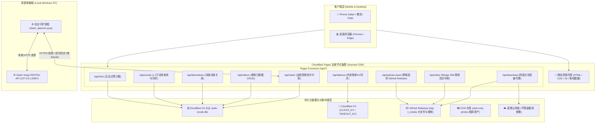
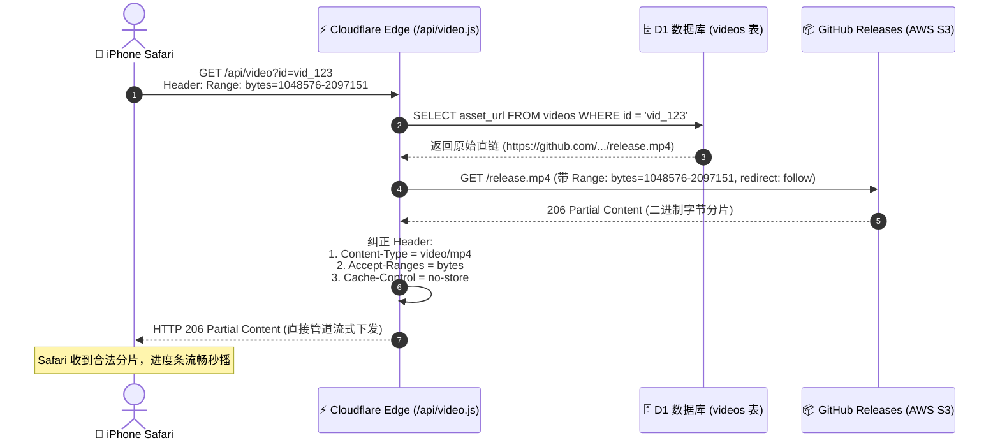

# Web-Cenj 云端数字枢纽系统全局架构与功能实现全景手册

> **文档版本**: v3.0.0 (增补在线资源底层架构专题)  
> **最后更新**: 2026-10-31  
> **文档定位**: 项目全局技术架构设计、每项功能底层实现机制、**在线资源（图库/流媒体/网盘/词库/信令）通信原理**、数据库字典与运维交接规范。无论是新接手的开发者还是协同 AI Agent，阅读本手册即可完整掌控本项目的所有细节与设计逻辑。

---

## 目录
1. [项目全景与核心使命](#1-项目全景与核心使命)
2. [总体系统架构与技术选型](#2-总体系统架构与技术选型)
3. [仓库代码全景目录树](#3-仓库代码全景目录树)
4. [核心功能模块与底层实现机制](#4-核心功能模块与底层实现机制)
   - [4.1 个人门户与互动点赞中枢 (index.html)](#41-个人门户与互动点赞中枢-indexhtml)
   - [4.2 英语综合查词与词根词族系统 (vocab.html)](#42-英语综合查词与词根词族系统-vocabhtml)
   - [4.3 沙县外卖记账助手 (takeout.html)](#43-沙县外卖记账助手-takeouthtml)
   - [4.4 精彩图库与流媒体视频系统 (gallery.html)](#44-精彩图库与流媒体视频系统-galleryhtml)
   - [4.5 资源网盘全球高速直链下载 (pan.html)](#45-资源网盘全球高速直链下载-panhtml)
   - [4.6 Clash Verge PC 远程控制与测速中枢 (clash.html)](#46-clash-verge-pc-远程控制与测速中枢-clashhtml)
   - [4.7 AI 试卷智能排版归档系统 (已独立归档)](#47-ai-试卷智能排版归档系统-已独立归档)
5. [深度专题：在线资源底层架构与流式传输原理](#5-深度专题在线资源底层架构与流式传输原理)
   - [5.1 在线资源核心痛点与架构选型总览](#51-在线资源核心痛点与架构选型总览)
   - [5.2 照片流媒体与独立 CDN 架构 (web-cenj-photos)](#52-照片流媒体与独立-cdn-架构-web-cenj-photos)
   - [5.3 视频点播与 HTTP Range 206 深度流式中继 (/api/video.js)](#53-视频点播与-http-range-206-深度流式中继-apivideojs)
   - [5.4 移动端跨越 GFW 免翻直传视频原理 (/api/upload-asset.js)](#54-移动端跨越-gfw-免翻直传视频原理-apiupload-assetjs)
   - [5.5 资源网盘双通道高速直链与断点分发 (/api/download.js)](#55-资源网盘双通道高速直链与断点分发-apidownloadjs)
   - [5.6 1.1万全量英语词库云边端协同与离线存储架构](#56-11万全量英语词库云边端协同与离线存储架构)
   - [5.7 跨 NAT 局域网反向信标穿透与 Clash 远程信令总线](#57-跨-nat-局域网反向信标穿透与-clash-远程信令总线)
6. [数据库表结构与存储设计全解](#6-数据库表结构与存储设计全解)
7. [外部守护进程与内网穿透机制](#7-外部守护进程与内网穿透机制)
8. [运维部署、数据迁移与自动化脚本指南](#8-运维部署数据迁移与自动化脚本指南)
9. [接手开发者与 Agent 避坑与故障排查速查表](#9-接手开发者与-agent-避坑与故障排查速查表)

---

## 1. 项目全景与核心使命

### 1.1 项目定位
本项目（`web-cenj`）是一个**多端云边协同的现代化个人数字枢纽**。基于 **Cloudflare Pages 全球边缘网络** 构建，融合无服务器计算（Serverless Functions）、分布式数据库（Cloudflare D1 / KV）、海量免费对象存储通道（GitHub Releases Asset Proxy + Dedicated CDN）以及本地 Windows 静默守护进程，形成了高度可用、零服务器成本、毫秒级加载且深度适配 iPhone 移动端的全栈应用集群。

### 1.2 核心价值与解决的痛点
1. **零成本与高可用**：所有基础设施均运行在 Cloudflare 和 GitHub 的免费高可用配额内，无需租用昂贵的固定 VPS 云主机，无运维账单负担。
2. **移动端深度调优**：所有前端页面均采用原生无依赖单页设计，界面深度适配 iOS Safari 的安全区域（Safe Area）、手势滑动、触摸阻尼、键盘弹起、离线存储限制（PWA 特性）。
3. **跨网络双向穿透**：通过 Cloudflare D1 边缘数据库作为“信令中继站”，突破家庭宽带无公网 IP、无端口映射的限制，让手机在 4G/5G 移动蜂窝网络下能实时控制家中 PC 电脑的代理状态、执行节点测速与换线。
4. **大文件与流媒体自由**：利用 GitHub Releases 突破静态页面托管大小限制，借助 Cloudflare Pages Function 中继流实现 HTTP Range 206 断点续传，让 iOS Safari 与 Chrome 能够像点播商业视频流媒体一样秒播高清视频，并实现大文件直连极速下载。

---

## 2. 总体系统架构与技术选型

### 2.1 架构拓扑图



---

## 3. 仓库代码全景目录树

```text
f:\zuomian\code\antitest\ (或 f:\zuomian\code\web-cenj\)
│
├── index.html                  # 门户首页 (个人展示、互动点赞、功能导航、Clash暗号入口)
├── vocab.html                  # 英语综合查词系统 (人教版高中7册 + 四六级全量 11,160 词)
├── takeout.html                # 沙县外卖记账助手前端 (多人账单分摊、矩阵计算、状态管理)
├── gallery.html                # 精彩图库与视频流媒体中心 (WebP 照片流 + 在线秒播视频)
├── pan.html                    # 资源网盘下载门户 (双通道高速直下、多线程 Range 支持)
├── clash.html                  # Clash Verge 电脑端全屏远程中控台 (测速、切节点、状态监视)
│
├── left_avatar.png             # 首页展示头像 1
├── right_avatar.jpg            # 首页展示头像 2
├── OIP-C.jpg                   # 首页暗号触发头像 (5次连续点击呼出远程控制)
│
├── functions/                  # Cloudflare Pages Functions (Serverless 后端路由)
│   ├── _middleware.js          # 全局中间件 (CORS 跨域、日志打点)
│   └── api/
│       ├── click.js            # 网站实时点赞统计接口 (D1 site_stats / KV)
│       ├── vocab.js            # 词汇库查询、分册过滤、全量快照与管理端导入接口
│       ├── derivatives.js      # 词根词族、同根派生词图谱接口
│       ├── takeout.js          # 沙县外卖记账助手云端备份与还原 (KV takeout_backup_data)
│       ├── upload-asset.js     # 手机端直传视频中继代理 (流式转发至 GitHub Releases)
│       ├── video.js            # 视频流式播放与原画下载中继 (HTTP Range 206 / Safari 适配)
│       ├── videos.js           # 视频元数据增删查与 GitHub Releases 资产同步接口
│       ├── download.js         # 网盘文件全球直连代理 (支持 IDM 多线程分片下载)
│       └── clash.js            # Clash Verge 远程控制信令中枢 (心跳、测速、换节点、密码门禁)
│
├── data/                       # 静态数据与数据库初始化结构
│   ├── schema.sql              # Cloudflare D1 核心数据库表建表脚本
│   ├── vocab.json              # 全量静态离线词典 (高中7册+CET4+CET6, 11,160条, ~1.58MB)
│   ├── cet4.json               # 大学英语四级核心词汇分册数据 (4,544 词)
│   ├── cet6.json               # 大学英语六级核心词汇分册数据 (3,991 词)
│   ├── root_families.json      # 词根词族派生词关系映射表
│   └── csv/                    # 原始词库 CSV 数据归档与说明
│
├── js/
│   └── takeout.js              # 沙县外卖记账助手核心前端逻辑引擎 (62KB, 包含完整结算算法)
├── css/
│   └── takeout.css             # 沙县外卖记账助手独立样式表
│
├── posters/                    # 本地视频封面与默认海报资源
│   └── vid_img_0802.jpg
│
├── scripts/                    # 词库构建、D1同步、运维辅助脚本集
│   ├── build_vocab_html.py     # 词库离线单文件 HTML 打包器
│   ├── convert_csv_to_vocab.py # 课本 CSV 转换为标准 vocab JSON 格式
│   ├── fetch_and_prepare_cet.py# 从开源字典仓库抓取清洗四六级词库
│   ├── seed_cet.py             # 分批向远程 D1 数据库灌入四六级数据
│   ├── seed_d1.py              # 初始化并灌入高中课本基础词库
│   ├── sync_d1.py              # 高级 D1 双向同步与校验工具
│   ├── sync_photos.py          # 图库图片与 WebP CDN 自动同步工具
│   └── verify_vocab.py         # 词库数据完整性校验脚本
│
├── wrangler.jsonc              # Cloudflare Pages 配置文件 (D1 数据库与兼容性配置)
├── .gitignore                  # Git 忽略配置
└── PROJECT_ARCHITECTURE.md     # 本全局架构手册 (持续更新)
```

> **注**：早期开发阶段遗留的 AI 试卷智能排版项目相关文件（`main.py`、`exam.html`、`exam_typesetter/`、`sample_math_exam.*` 等共 31 个文件）已完整移入独立归档工程 [`F:\zuomian\code\exam-typesetter`](file:///f:/zuomian/code/exam-typesetter)，主站保持 100% 纯净。

---

## 4. 核心功能模块与底层实现机制

### 4.1 个人门户与互动点赞中枢 (`index.html`)
- **点赞持久化与防抖 (`/api/click.js`)**：前端点击时触发粒子动画与即时反馈（乐观更新），同时向 `/api/click` 发送 POST 请求。后端使用 Cloudflare D1 中的 `site_stats` 表通过 SQLite 原子事务自增：
  ```sql
  INSERT INTO site_stats (key, value) VALUES ('likes_count', ?)
  ON CONFLICT(key) DO UPDATE SET value = value + ?;
  ```
- **隐藏式暗号呼出 (Clash 远程控制入口)**：首页中间头像绑定了连点计数器：1 秒内连续点击 5 次，带有弹性缩放动画，判定触发暗号，在新标签页打开 `clash.html`。
- **密码保护门禁**：敏感工具（沙县外卖账单）接入前置密码弹窗，密码正确后使用 `sessionStorage` 暂存令牌并实现无缝跳转。

### 4.2 英语综合查词与词根词族系统 (`vocab.html`)
- **词库规模**：收录人教版高中英语全部 7 册课本词汇（2,625 词）以及大学英语四级（CET-4，4,544 词）和大学英语六级（CET-6，3,991 词），去重后总词库达 **11,160 词条**。
- **多维度前缀与变形索引**：在内存中建立 `_headLower` 与 `_keys` 倒排集合，支持原形（`apply`）、过去式/进行时（`applied` -> `apply`）、派生名词的秒级智能匹配。
- **课本/分册智能排序**：必修1~3 (1~3) -> 选必1~4 (4~7) -> 四级 CET-4 (10) -> 六级 CET-6 (11)，高中重点词条优先排列在最前列。
- **同根词拓展图谱**：通过 `/api/derivatives` 查询同根词群，卡片下方自动构建同根衍生关系图谱。
- **批量 CSV 课本符合度检测**：从 iPhone「文件」App 导入任意单词 CSV 表，系统在本地毫秒级匹配并给出每词的“在课本中/不在课本中”判定，支持一键导出 CSV 检测报告。

### 4.3 沙县外卖记账助手 (`takeout.html` & `js/takeout.js`)
- **折扣分摊数学模型**：
  $$\text{个人实付} = \text{个人所点原价} \times \left(\frac{\text{整单实付金额}}{\sum \text{各人原价之和}}\right) \pm \text{个人独占打包/派送费}$$
  精确到分，自动处理除不尽时的尾差，保证各人分摊金额之和严格等于实付总额。
- **多端无感同步 (`/api/takeout.js`)**：数据写入 Cloudflare KV 中的 `takeout_backup_data`，断网可离线计算，联网时点击同步或自动合并最新状态。
- **人性化催账文案生成**：内置一键复制模板，自动列出成员所点菜品、分摊金额、收款码指引等。

### 4.4 精彩图库与流媒体视频系统 (`gallery.html`)
- **精选图库**：展示高质量精选摄影作品，通过专用 CDN 加速。
- **视频天地**：支持高清视频在移动端 Safari 和 PC Chrome 上的秒开在线点播、拖拽进度条与原画直接下载。
- **移动端视频直传**：手机无需梯子，在网页内一键挑选视频上传至云端。

### 4.5 资源网盘全球高速直链下载 (`pan.html` & `/api/download.js`)
- **通道一（全球边缘中继直链）**：针对预设安装包（如 Clash.Verge 安装包、CFMA 安卓包），通过 `/api/download?file=...` 设置 `Content-Disposition: attachment` 驱动原生下载，支持多线程分片下载。
- **通道二（蓝奏云备用镜像）**：内置备用蓝奏云不限速链接，双重容灾。

### 4.6 Clash Verge PC 远程控制与测速中枢 (`clash.html`)
- **75 秒心跳在线容差算法**：电脑端守护进程定时上报心跳至 `clash_control` 的 `heartbeat` 记录，边缘端计算 UTC 时间差值 `diff_sec <= 75` 判定电脑在线。
- **常用地区测速与智能换线**：预设 6 大主流地区（香港、日本、新加坡、台湾、韩国、美国），守护进程后台并发测量延迟，手机端点击“一键切至最优节点”秒级执行。
- **安全鉴权**：独立访问密码验证（默认 `8888`，支持在线修改），手机端支持 30 天免密记住密码；防无限 401 死循环拦截。

### 4.7 AI 试卷智能排版归档系统 (已独立归档)
- 原始工程已移入 [`F:\zuomian\code\exam-typesetter`](file:///f:/zuomian/code/exam-typesetter)，包含 Word/PDF 试卷提取、DeepSeek 题目结构化模型、Word OMML 原生数学公式互转引擎及 FastAPI 云端微服务。

---

## 5. 深度专题：在线资源底层架构与流式传输原理

本项目之所以能在**零服务器租金**的前提下，实现毫秒级大图加载、iPhone 视频秒播无拖拽卡顿、免代理越墙大文件直传以及无公网 IP 电脑反向控制，完全依赖于一套精心设计的**边缘流式代理与对象分发管道**。

### 5.1 在线资源核心痛点与架构选型总览

| 资源类别 | 原始技术痛点 | 工业级解决方案 | 核心承载组件 |
| :--- | :--- | :--- | :--- |
| **高清相册大图** | 数百张实拍照片若提交进 Git 仓库，会导致仓库迅速膨胀至数 GB，部署超时崩溃 | 独立创建静态资产专有仓库，通过脚本在本地自动压制 2K WebP，发布至独立 CDN | `web-cenj-photos` + `sync_photos.py` |
| **视频点播流媒体** | 1. Git 单文件有 100MB 限制<br/>2. GitHub Releases 默认 `octet-stream` 格式导致 Safari 播放器打叉<br/>3. Safari 发送 `Range: bytes=0-1` 探针失败导致无法拖拽进度条 | 边缘 Worker 中继管道，捕获 Range 头并跟随 302 重定向，修正 MIME Type 并回传标准 `206 Partial Content`，彻底禁用边缘静态缓存 | `/api/video.js` |
| **移动端视频上传** | 国内手机在无代理网络下，访问 `uploads.github.com` 会频繁遭到 GFW 的 TCP Reset 阻断，且存在浏览器 CORS 跨域报错 | 手机将文件流发给同源边缘接口，由 Cloudflare 海外节点作为中继代理将二进制流推入 GitHub Releases 容器，并自动注册 D1 元数据 | `/api/upload-asset.js` |
| **大型安装包下载** | GitHub Release 附件在不同运营商下解析缓慢，普通网页重定向无法激活 IDM 多线程分段下载 | 边缘流式代理接管下载，设置 `Accept-Ranges: bytes` 与自定义编码附件响应头，结合国内蓝奏云做双通道容灾 | `/api/download.js` |
| **1.1万条完整词库** | JSON 字符串在内存达数兆，写入 `localStorage` 会超出 iOS Safari 5MB 单域名上限导致静默存储失败 | 采用 HTML5 异步 IndexedDB 本地数据库存储，结合 Stale-While-Revalidate 云端静默对比更新 | `pep_vocab_offline_db_v2` + `/api/vocab.js` |
| **家庭电脑内网控制** | 家庭电脑处于路由器 NAT 后方，无公网 IPv4，手机无法主动向电脑发起连接 | 反向信标穿透模型：以 Cloudflare D1 作为无感中继信箱，电脑主动出站轮询指令并回传结果 | `clash_control` + `clash_daemon.pyw` |

---

### 5.2 照片流媒体与独立 CDN 架构 (`web-cenj-photos`)

#### 1. 架构解耦原则
若将多媒体静态大图与业务代码混在同一个 Git 仓库，会导致每次代码提交都需要拉取巨量二进制差异。为此，图库资产被彻底剥离到独立的物理工程：`F:\zuomian\code\web-cenj-photos`，并作为独立的 Cloudflare Pages 项目（`https://web-cenj-photos.pages.dev`）进行全球分发。

#### 2. 本地自动化处理流水线 (`sync_photos.py`)
当用户向 `originals/s`（生活组）或 `originals/p`（摄影组）放入原始照片后，运行本地同步脚本：
1. **EXIF 旋转纠正**：通过 `ImageOps.exif_transpose(img)` 自动检测并校正手机横竖拍摄产生的方向偏转，防止网页呈现倒置。
2. **高质量尺寸重采样**：检测图像长边，若超过 2560px，采用高质量 `Image.Resampling.LANCZOS` 采样算法降采样至 2K 分辨率，兼顾视网膜屏细腻度与传输速度。
3. **WebP 深度压缩**：转换为 `WEBP` 格式，设置 `quality=86`，启用极度压缩优化算法 `method=6`。单张 8MB~15MB 的原始实拍图被压缩至 200KB~400KB，体积缩减 95% 以上，且肉眼几乎无损。
4. **生成图像索引清单 (`dist/images.json`)**：自动遍历压缩后的成果，生成带分组相对路径的 JSON 数组（如 `["s/IMG_001.webp", "p/IMG_002.webp"]`）。
5. **增量边缘推送**：脚本内置 `npx wrangler pages deploy dist --project-name=web-cenj-photos`，直接将 `dist` 目录增量推送到 Cloudflare 边缘 CDN。

#### 3. 前端按需加载与 Anycast 强缓存
在 `gallery.html` 中：
- 页面加载时向 `https://web-cenj-photos.pages.dev/images.json` 获取最新列表；
- 动态拼接图片 URL：`${IMAGE_CDN_BASE}/${relPath}`；
- 图片标签原生支持 `loading="lazy"`，仅在滑入可视区域时触发网络请求；
- Cloudflare 对该 CDN 站点的 WebP 图片默认开启长期边缘强缓存，二次进入页面直接从浏览器本地或最近边缘 PoP 节点瞬间加载。

---

### 5.3 视频点播与 HTTP Range 206 深度流式中继 (`/api/video.js`)

这是全站技术含量最高的媒体流式管道之一。

#### 1. 为什么不能直接将视频文件丢在 GitHub Releases 上让 `<video>` 播放？
- **原因 A（MIME Type 致命错误）**：GitHub Releases 附件属于二进制存储，下载响应头默认返回 `Content-Type: application/octet-stream`。桌面 Chrome 偶有宽容度，但 **iOS Safari 的 WebKit 内核非常严苛**，发现不是 `video/mp4` 或 `video/quicktime` 时，会直接在播放器正中央显示一个带有斜杠的“无法播放”图标。
- **原因 B（Range 探针与 302 重定向丢失）**：Safari 启动视频播放前，必须先发送 `Range: bytes=0-1` 测试服务端是否支持分段下载，随后才会读取视频的元数据（moov atom）。直接访问 GitHub 下载直链时会发生 302 重定向到 Amazon S3 或 Fastly 节点，Safari 的底层网络库在跨域重定向时极易丢失 Range 标头，导致连接失败。
- **原因 C（边缘缓存雪崩）**：如果 CDN 边缘节点对视频进行了错误的缓存，将用户请求进度条中间位置的 206 分片响应缓存成了普通的 200 响应，用户再次拖动进度条时就会直接从头播放或音画错位。

#### 2. `/api/video.js` 管道实现机制



- **双向流式透传 (Streaming Pipe)**：Worker 不会在内存中缓冲完整的几十兆视频，而是通过 `upstreamResp.body` 可读流以管道方式直接下发给客户端，内存消耗始终在几 KB 级别，吞吐延迟在毫秒级。
- **精准的设备 User-Agent 感知**：针对苹果 `.mov` 实拍格式，自动识别如果是 iOS/Mac 设备，精确注入 `Content-Type: video/quicktime`；其余环境使用 `video/mp4`。
- **严格禁止边缘静态缓存**：强制注入 `Cache-Control: no-cache, no-store, must-revalidate`，确保每一次进度条拖拽均触发真实的 Range 请求，彻底杜绝分片错位问题。

---

### 5.4 移动端跨越 GFW 免翻直传视频原理 (`/api/upload-asset.js`)

为实现手机随手录制的视频能直接进入云端图库，同时不受国内网络环境限制，系统设计了**边缘逆向转发代理**。

#### 1. 痛点解析
- 在国内手机 4G/5G 直连 `uploads.github.com` 时，该域名的 IP 经常被防火墙通过 TCP RST 包阻断，导致上传进度中途直接报“网络连接中断”。
- 浏览器的跨域预检（OPTIONS）请求直接发给 GitHub API 时，因未配置对应的 CORS 白名单而会被浏览器内核直接掐断。

#### 2. 解决方案：边缘无感中继管道
1. **客户端统一同源交互**：手机前端直接向同源端点 `POST /api/upload-asset` 发起请求。
2. **海外边缘节点接力**：Cloudflare 负责将国内手机的流量调度至其在亚太最佳链路的边缘服务器。由位于海外自由网络环境的 Cloudflare Worker 代理客户端与 GitHub 建立安全的 TLS 握手。
3. **动态容器自愈**：Worker 自动向 GitHub API 探测是否存在标签为 `v_media` 的 Release。如果不存在，则由 Worker 自动发起创建该 Release 容器的请求。
4. **流式推流转发**：手机客户端在请求体（`request.body`）中携带的视频二进制流，被 Worker 直接以流的方式无缝管道转发给 GitHub 的 `upload_url`。
5. **D1 元数据自动入库**：当 GitHub 传回上传成功的 JSON 响应后，Worker 在边缘内部直接执行 SQL，将该视频的 ID、标题、大小、下载直链写入 D1 数据库：
   ```sql
   INSERT INTO videos (id, title, description, duration, file_size, poster_url, asset_url)
   VALUES (?, ?, ?, ?, ?, ?, ?);
   ```
整个过程对用户手机而言就是上传给普通国内网站，无需手机开启任何网络代理工具。

---

### 5.5 资源网盘双通道高速直链与断点分发 (`/api/download.js`)

针对 PC 电脑端（如 47MB 的 Clash.Verge 安装包）或安卓手机端（CFMA 安装包），系统提供了兼顾全球与国内极速的双通道体系。

#### 1. 通道一：全球边缘中继直链 (`/api/download.js`)
- **预设短链映射**：客户端访问 `/api/download?file=clashverge`，边缘端内置了各软件最新版本在 GitHub Releases 的映射关系。
- **断点续传与多线程加速**：
  - 中继接口不仅支持标准 GET 请求，还完美支持 **HEAD** 探测请求与 **Range** 标头。
  - 许多高速下载工具（如 IDM、迅雷、Aria2）在下载前会发送 HEAD 请求探查文件大小和是否支持分段下载。`/api/download.js` 针对 HEAD 请求先行返回文件总长度和 `Accept-Ranges: bytes`；
  - 当 IDM 开启 8~32 线程同时并发索取不同字节段时，Worker 会分别并发拉取并回传分片，实现下载速度拉满。
- **强制触发浏览器原生下载弹窗**：通过在响应头中构造 RFC 5987 规范的 `Content-Disposition`：
  ```javascript
  const encodedFileName = encodeURIComponent(fileName);
  respHeaders.set("Content-Disposition", `attachment; filename="${fileName}"; filename*=UTF-8''${encodedFileName}`);
  ```
  避免了某些安卓浏览器误将 `.apk` 当成文本解析乱码的问题。

#### 2. 通道二：蓝奏云备用国内镜像
- 针对海外出口极其拥堵或学校/公司内网完全屏蔽 GitHub 域名的极端环境，网页上并列提供了蓝奏云（国内不限速云存储）的不限速备用镜像链接（带固定提取码 `pass`），构建了 100% 可用的双重容灾保障。

---

### 5.6 1.1万全量英语词库云边端协同与离线存储架构

#### 1. 词库数据的构成与规模
- **人教版高中英语 7 册全量**（必修一至三、选择性必修一至四）：共 2,625 个课标词条。
- **大学英语四级核心词库 (CET-4)**：共 4,544 个词条。
- **大学英语六级核心词库 (CET-6)**：共 3,991 个词条。
- **三库去重合并总量**：**11,160 词条**。

#### 2. 存储与传输的技术陷阱：Safari 5MB 硬限制
若按照传统单页 Web 应用的做法，将 11,160 个单词的完整词典转为 JSON 存放在 `localStorage` 中：
- `vocab.json` 磁盘大小约为 **1.58 MB**；
- 浏览器在 `localStorage` 存储时采用 UTF-16 编码，每个字符占 2 字节，导致该字符串在内存中实际占用 **3.2 MB 以上**；
- **iOS Safari 对单个域名的 `localStorage` 存在极其严格的 5MB 硬限制**。一旦同时存储了自定义词库、历史记录、其他页面数据，总容量就会瞬间溢出，导致 `setItem()` 抛出 `QuotaExceededError` 异常，使得数据根本无法保存，手机端频繁丢词。

#### 3. 终极解决方案：HTML5 IndexedDB 异步数据库 (`pep_vocab_offline_db_v2`)
系统在前端深度改造了存储驱动：
- 采用原生的浏览器级对象数据库 **IndexedDB**（名称：`pep_vocab_offline_db_v2`，仓库名：`vocab_store`）；
- 单域名容量上限高达几百 MB，不仅毫无溢出风险，而且由于底层由 SQLite 原生驱动，读取 11,160 个词条的对象反序列化耗时仅为 **30~50 毫秒**；
- **旧缓存自动淘汰**：页面初始化时检测并清理老旧的 `pep_vocab_baseline_cache_v1`（早期 2625 词的小缓存），保证用户设备平滑升级到 11,160 词，绝不锁死在旧版本。

#### 4. Stale-While-Revalidate（即开即显 + 静默更新）
1. 用户在 iPhone 或电脑打开 `vocab.html`，系统第一毫秒内直接从 IndexedDB 加载词库建立内存倒排索引，用户感觉**完全是原生 App 般的零等待瞬间呈现**。
2. 后台异步向 Cloudflare Pages 边缘接口 `/api/vocab` 发起轻量版本探测。若云端词典有修订，后台静默拉取并在后台更新 IndexedDB，实现下一次打开自动生效，兼具离线可用性与云端一致性。

---

### 5.7 跨 NAT 局域网反向信标穿透与 Clash 远程信令总线

本模块展现了如何在没有公网 IP、没有购买内网穿透商业服务的前提下，实现外网对家庭 PC 的低延迟控制。

```
[ 手机 4G/5G 客户端 ]
         |
         | 1. POST /api/clash (action: dispatch_command, command: switch_node, payload: 香港01)
         v
+-------------------------------------------------------------+
| Cloudflare D1 边缘数据库 (clash_control 表)                   |
| 记录 ID='latest':                                           |
| { command: 'switch_node', payload: '香港01', status: 'pending' } |
+-------------------------------------------------------------+
         ^
         | 2. 电脑端出站轮询 (HTTPS GET /api/clash, 每6秒/夜间30秒)
         |    抓取到 status='pending' 的任务并开始执行
         |
         | 3. POST /api/clash (action: report_result, status: 'done', result: '已切换至 香港01')
[ 家用 Windows 电脑后台守护进程 clash_daemon.pyw ]
         |
         | 4. 本地回环网络控制 (HTTP PUT http://127.0.0.1:9097/proxies/GLOBAL)
         v
[ 本地运行的 Clash Verge 核心 ]
```

#### 1. 穿透原理：反向长轮询信标 (Inverted Beacon)
- **家庭网络限制**：家用宽带分配的是局域网内网 IP，光猫/路由器不允许外网主动发起入站连接（Inbound TCP）。
- **破局思路**：将传统的“外网主动推”改为“电脑内网主动拉”。因为 NAT 防火墙对内网电脑发往互联网的出站请求（Outbound HTTPS）是 100% 放行的。
- **信箱机制**：电脑端静默守护脚本 `clash_daemon.pyw` 充当驻守信使，不断向 Cloudflare 边缘的 `clash_control` 数据库“看一眼是否有新信件”。一旦发现手机放进来的 `pending` 指令，立刻提取并在本地调用 `http://127.0.0.1:9097` 执行，随后将回执改写为 `done`。

#### 2. 滑动心跳窗口与在线状态判定
- 电脑守护进程每周期上报一次当前电脑的时间和状态。
- 云端以当前时间差值 `diff_sec` 计算：
  - `diff_sec <= 75 秒`：判定电脑**在线**（绿色指示灯亮起，标注几秒前活跃）；
  - `diff_sec > 75 秒`：判定电脑**已关机 / 离线 / 睡眠断网**（红色指示灯，标注最后活跃于 XX 分钟前）。
- 手机端每次进入页面无需触发电脑唤醒，直接从云端读取最后状态，体验丝滑流畅。

---

## 6. 数据库表结构与存储设计全解

本系统核心结构化数据存放在 Cloudflare D1 (`web-vocab-db`, ID: `5e691588-a2df-428a-b786-d5f9703c9554`)。

### 6.1 数据表全景设计

#### 1. 课本与英语词汇表 (`textbook_words`)
存储 11,160 词条。
```sql
CREATE TABLE IF NOT EXISTS textbook_words (
  id INTEGER PRIMARY KEY AUTOINCREMENT,
  book TEXT NOT NULL,         -- 册别全称 (如: '人教版高中英语必修第一册', '大学英语四级 (CET-4)')
  unit TEXT NOT NULL,         -- 单元索引 (如: '1', 'Welcome', 四六级字母索引 'A')
  word TEXT NOT NULL,         -- 单词原词或短语 (如: 'accommodation')
  pos TEXT DEFAULT '',        -- 词性 (如: 'n.', 'vt. & vi.')
  meaning TEXT DEFAULT '',    -- 中文释义 (如: '住处；停留处')
  font TEXT DEFAULT '白体',   -- 课本字体排版等级 ('黑体', '白体', 'CET-4核心')
  note TEXT DEFAULT '',       -- 备注标记 (如: '新课标', 'CET-4')
  head_lower TEXT NOT NULL    -- 归一化小写无符号词头，用于加速模糊与前缀检索
);

CREATE INDEX IF NOT EXISTS idx_tb_head ON textbook_words(head_lower);
CREATE INDEX IF NOT EXISTS idx_tb_book ON textbook_words(book);
CREATE INDEX IF NOT EXISTS idx_tb_word ON textbook_words(word);
```

#### 2. 词根词族关系表 (`word_derivatives`)
```sql
CREATE TABLE IF NOT EXISTS word_derivatives (
  id INTEGER PRIMARY KEY AUTOINCREMENT,
  root_group TEXT DEFAULT '',     -- 词根词族分组标识 (如: 'act_group')
  trigger_word TEXT NOT NULL,     -- 触发索引词 (如: 'active')
  word TEXT NOT NULL,             -- 关联派生词 (如: 'activity')
  pos TEXT DEFAULT '',            -- 词性
  meaning TEXT DEFAULT '',        -- 释义
  level TEXT DEFAULT '高考拓展'    -- 难度考纲等级
);

CREATE INDEX IF NOT EXISTS idx_deriv_trigger ON word_derivatives(trigger_word);
CREATE INDEX IF NOT EXISTS idx_deriv_word ON word_derivatives(word);
CREATE INDEX IF NOT EXISTS idx_deriv_root ON word_derivatives(root_group);
```

#### 3. 网站互动统计表 (`site_stats`)
```sql
CREATE TABLE IF NOT EXISTS site_stats (
  key TEXT PRIMARY KEY,           -- 统计指标标识 (如: 'likes_count')
  value INTEGER DEFAULT 0         -- 当前计数值
);
```

#### 4. 视频云端资产元数据表 (`videos`)
```sql
CREATE TABLE IF NOT EXISTS videos (
  id TEXT PRIMARY KEY,            -- 视频唯一标识 (如: 'vid_1729688400_a1b2')
  title TEXT NOT NULL,            -- 视频名称 (如: '海边日落短片')
  description TEXT DEFAULT '',    -- 视频描述
  duration INTEGER DEFAULT 0,     -- 时长 (秒)
  file_size INTEGER DEFAULT 0,    -- 文件大小 (字节)
  poster_url TEXT DEFAULT '',     -- 封面海报直链 (若为空则自动回退默认海报)
  asset_url TEXT NOT NULL,        -- GitHub Releases 的原始二进制下载直链
  download_count INTEGER DEFAULT 0,-- 播放与下载累计计数
  created_at DATETIME DEFAULT CURRENT_TIMESTAMP
);
```

#### 5. Clash Verge 远程穿透控制表 (`clash_control`)
```sql
CREATE TABLE IF NOT EXISTS clash_control (
  id TEXT PRIMARY KEY,            -- 信令类型: 'latest', 'heartbeat', 'profiles', 'nodes', 'speed_data', 'auth_pwd'
  command TEXT DEFAULT '',        -- 当前指令名称: 'switch_node', 'update_sub', 'check_delay', 'restart'
  payload TEXT DEFAULT '',        -- 指令参数或大块 JSON 负载 (如节点列表、测速结果、配置详情)
  status TEXT DEFAULT 'pending',  -- 执行状态: 'pending', 'done', 'error', 'online'
  result TEXT DEFAULT '',         -- PC 执行结果反馈或心跳说明
  dispatched_at TEXT,             -- 指令下发时间戳 (ISO)
  responded_at TEXT,              -- 电脑响应并执行完成时间戳 (ISO)
  updated_at DATETIME DEFAULT CURRENT_TIMESTAMP
);
```

### 6.2 Cloudflare KV 键值设计
- 命名空间：`TAKEOUT_KV` (代码中兼容 `CLICKS_KV`)
- 核心键：`takeout_backup_data`
- 存储内容：沙县外卖记账助手的完整账单对象，序列化为 JSON 字符串存储。

---

## 7. 外部守护进程与内网穿透机制

### 7.1 电脑端守护服务架构 (`C:\Users\cenji\.clash_remote\`)
- **主程序**：`clash_daemon.pyw`（无控制台窗口 Python 脚本）。
- **启动引导**：`launch.vbs`（通过 Windows Script Host 调用系统自带 `wscript.exe` 静默启动，无 CMD 黑框）。
- **开机自启快捷方式**：
  `C:\Users\cenji\AppData\Roaming\Microsoft\Windows\Start Menu\Programs\Startup\ClashRemoteSync.lnk`。
- **本地 API 探测**：自动嗅探 `C:\Users\cenji\AppData\Roaming\io.github.clash-verge-rev.clash-verge-rev\config.yaml`，提取动态密钥并访问本地 REST 接口：`http://127.0.0.1:9097`。

### 7.2 守护进程常用维护命令
在电脑端 PowerShell 中运行：
```powershell
# 1. 检查守护进程运行状态
Get-Process pythonw | Where-Object { $_.Path -like "*python*" }

# 2. 查看最近的运行日志
Get-Content -Tail 50 "C:\Users\cenji\.clash_remote\daemon.log"

# 3. 手动重启守护进程
& "C:\Users\cenji\.clash_remote\restart.ps1"
```

---

## 8. 运维部署、数据迁移与自动化脚本指南

### 8.1 Cloudflare Pages 线上部署命令
本项目为纯静态 + Functions 架构，部署无需 npm 构建，执行直接上传即可：
```powershell
cd f:\zuomian\code\antitest
npx wrangler pages deploy . --project-name=web-cenj
```

### 8.2 数据库初始化与词库灌库流程
当数据库重置或迁移至新账号时，按照以下顺序执行脚本：
```powershell
# 1. 初始化 D1 表结构
npx wrangler d1 execute web-vocab-db --remote --file=data/schema.sql

# 2. 抓取与清洗最新四六级词库 (生成 data/cet4.json 与 data/cet6.json)
python scripts/fetch_and_prepare_cet.py

# 3. 灌入高中课本词库到 D1
python scripts/seed_d1.py

# 4. 灌入四六级词库到 D1
python scripts/seed_cet.py

# 5. 生成前端静态离线合集 data/vocab.json (包含11,160词)
node -e "
const fs = require('fs');
const v = JSON.parse(fs.readFileSync('data/vocab.json', 'utf8'));
const c4 = JSON.parse(fs.readFileSync('data/cet4.json', 'utf8'));
const c6 = JSON.parse(fs.readFileSync('data/cet6.json', 'utf8'));
const highSchool = v.words.filter(w => !w.b.includes('四级') && !w.b.includes('六级') && !w.b.includes('CET'));
const all = [...highSchool, ...c4.words, ...c6.words];
fs.writeFileSync('data/vocab.json', JSON.stringify({ version: '2.0.0', total: all.length, words: all }), 'utf8');
console.log('合并完成，共计:', all.length, '词条');
"
```

---

## 9. 接手开发者与 Agent 避坑与故障排查速查表

| 故障现象 | 潜在原因 | 排查步骤与修复方案 |
| :--- | :--- | :--- |
| **手机查词看不到四六级，只显示 2,625 词** | 手机 Safari 缓存了早期版本的 `localStorage` 数据，未触发更新 | 在 `vocab.html` 内部已加入自动清空旧缓存机制；用户在页面点击一次“恢复默认全量词库”或在手机 Safari 清除该网站缓存即可立即恢复 11,160 词。 |
| **电脑开机但网页上 Clash 状态显示“离线”** | 1. 守护进程崩溃或未启动<br/>2. 电脑未联网<br/>3. Clash Verge 未开启外部控制端口 (9097) | 1. 检查电脑任务管理器是否有 `pythonw.exe` 进程。<br/>2. 查看 `C:\Users\cenji\.clash_remote\daemon.log` 日志。<br/>3. 执行 `restart.ps1` 脚本重新拉起。 |
| **手机上传视频提示“网络连接中断”** | 尝试直连 GitHub 上传域名遭到拦截 | 必须确保走 `/api/upload-asset` 边缘中继接口；同时检查前端填写的 GitHub Token 是否具备目标仓库的 `repo` 写权限。 |
| **iPhone 播放视频黑屏或进度条无法拖拽** | 视频响应头缺失 `Accept-Ranges` 或 Content-Type 为 `octet-stream` | 检查 `/api/video.js` 是否生效，确认响应状态码为 `206 Partial Content`，Safari 必须识别到 `video/mp4` 或 `video/quicktime` 才能正常解码。 |
| **Wrangler 报 7403 账号未授权** | 本地 Wrangler 凭证过期或 account_id 漂移 | 运行 `npx wrangler whoami` 重新登录，或直接使用生产环境绑定的 GitHub Actions / Pages 后台自动构建部署。 |
| **记账助手多端账单不同步** | Cloudflare KV 绑定变量名未关联 | 检查 `wrangler.jsonc` 中是否正确绑定了 `TAKEOUT_KV` 或 `CLICKS_KV`。 |

---
*本手册将随着系统功能的迭代演进而持续保持同步更新。*
