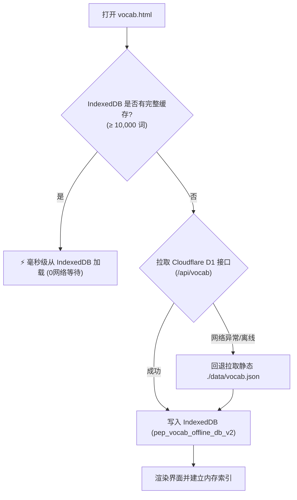

# Web-Cenj 云端数字枢纽系统全局架构与功能实现全景手册

> **文档版本**: v2.5.0  
> **最后更新**: 2026-10-31  
> **文档定位**: 项目全局技术架构设计、每项功能底层实现机制、数据库字典与运维交接规范。无论是新接手的开发者还是协同 AI Agent，阅读本手册即可完整掌控本项目的所有细节与设计逻辑。

---

## 目录
1. [项目全景与核心使命](#1-项目全景与核心使命)
2. [总体系统架构与技术选型](#2-总体系统架构与技术选型)
3. [仓库代码全景目录树](#3-仓库代码全景目录树)
4. [核心功能模块与底层实现机制](#4-核心功能模块与底层实现机制)
   - [4.1 个人门户与互动点赞中枢 (index.html)](#41-个人门户与互动点赞中枢-indexhtml)
   - [4.2 英语综合查词与词根词族系统 (vocab.html)](#42-英语综合查词与词根词族系统-vocabhtml)
   - [4.3 沙县外卖记账助手 (takeout.html)](#43-沙县外卖记账助手-takeouthtml)
   - [4.4 精彩图库与流媒体视频系统 (gallery.html)](#44-精彩图库与流媒体视频系统-galleryhtml)
   - [4.5 资源网盘全球高速直链下载 (pan.html)](#45-资源网盘全球高速直链下载-panhtml)
   - [4.6 Clash Verge PC 远程控制与测速中枢 (clash.html)](#46-clash-verge-pc-远程控制与测速中枢-clashhtml)
   - [4.7 AI 试卷智能排版系统 (main.py / exam_typesetter)](#47-ai-试卷智能排版系统-mainpy--exam_typesetter)
5. [数据库表结构与存储设计全解](#5-数据库表结构与存储设计全解)
6. [外部守护进程与内网穿透机制](#6-外部守护进程与内网穿透机制)
7. [运维部署、数据迁移与自动化脚本指南](#7-运维部署数据迁移与自动化脚本指南)
8. [接手开发者与 Agent 避坑与故障排查速查表](#8-接手开发者与-agent-避坑与故障排查速查表)

---

## 1. 项目全景与核心使命

### 1.1 项目定位
本项目（`web-cenj`）是一个**多端云边协同的现代化个人数字枢纽**。基于 **Cloudflare Pages 全球边缘网络** 构建，融合无服务器计算（Serverless Functions）、分布式数据库（Cloudflare D1 / KV）、海量免费对象存储通道（GitHub Releases Asset Proxy + Dedicated CDN）以及本地 Windows 静默守护进程，形成了高度可用、零服务器成本、毫秒级加载且深度适配 iPhone 移动端的全栈应用集群。

### 1.2 核心价值与解决的痛点
1. **零成本与高可用**：所有基础设施均运行在 Cloudflare 和 GitHub 的免费高可用配额内，无需租用昂贵的固定 VPS 云主机，无运维账单负担。
2. **移动端深度调优**：所有前端页面均采用原生无依赖单页或微前端设计，界面深度适配 iOS Safari 的安全区域（Safe Area）、手势滑动、触摸阻尼、键盘弹起、离线存储限制（PWA 特性）。
3. **跨网络双向穿透**：通过 Cloudflare D1 边缘数据库作为“信令中继站”，突破家庭宽带无公网 IP、无端口映射的限制，让手机在 4G/5G 移动蜂窝网络下能实时控制家中 PC 电脑的代理状态、执行节点测速与换线。
4. **大文件与流媒体自由**：利用 GitHub Releases 突破静态页面托管大小限制，借助 Cloudflare Pages Function 中继流实现 HTTP Range 206 断点续传，让 iOS Safari 与 Chrome 能够像点播商业视频流媒体一样秒播高清视频，并实现大文件直连极速下载。

---

## 2. 总体系统架构与技术选型

### 2.1 架构拓扑图

```mermaid
flowchart TD
    subgraph ClientLayer["客户端层 (Mobile & Desktop)"]
        iOS["📱 iPhone Safari / 微信 / PWA"]
        Desktop["💻 桌面浏览器 (Chrome / Edge)"]
    end

    subgraph EdgeLayer["Cloudflare Pages 边缘节点集群 (Anycast CDN)"]
        PagesStatic["📄 静态资源托管 (HTML / CSS / JS / 离线数据)"]
        
        subgraph ServerlessFunctions["Pages Functions (/api/*)"]
            F_Click["/api/click (互动点赞计数)"]
            F_Vocab["/api/vocab (1.1万词库查询与同步)"]
            F_Deriv["/api/derivatives (词根词族关系)"]
            F_Takeout["/api/takeout (外卖账单KV同步)"]
            F_Video["/api/video (Range 206 视频流式中继)"]
            F_Videos["/api/videos (视频元数据 CRUD)"]
            F_Upload["/api/upload-asset (跨域直传 GitHub Release)"]
            F_Download["/api/download (网盘分流直链代理)"]
            F_Clash["/api/clash (远程控制信令中枢)"]
        end
    end

    subgraph StorageLayer["持久化数据与对象存储层"]
        D1["🗄️ Cloudflare D1 SQL (web-vocab-db)"]
        KV["🔑 Cloudflare KV (CLICKS_KV / TAKEOUT_KV)"]
        GH_Media["📦 GitHub Releases (tag: v_media 大文件与视频)"]
        GH_Photos["🖼️ CDN 仓库 (web-cenj-photos 图库资产)"]
        Lanzou["☁️ 蓝奏云网盘 (不限速备用镜像)"]
    end

    subgraph HomePCLayer["家庭电脑端 (Local Windows PC)"]
        Daemon["⚙️ 后台守护进程 (clash_daemon.pyw)"]
        ClashCore["🌐 Clash Verge RESTful API (127.0.0.1:9097)"]
    end

    subgraph AICloudLayer["AI 与计算引擎 (可选扩展服务)"]
        FastAPIEngine["🐍 FastAPI 试卷排版后端 (Render/Zeabur)"]
        DeepSeekAPI["🤖 DeepSeek API (大模型结构化解析)"]
    end

    ClientLayer --> PagesStatic
    ClientLayer --> ServerlessFunctions

    F_Click --> D1
    F_Vocab --> D1
    F_Deriv --> D1
    F_Videos --> D1
    F_Clash --> D1
    F_Takeout --> KV

    F_Upload --> GH_Media
    F_Video --> GH_Media
    F_Download --> GH_Media
    F_Download --> Lanzou

    Daemon <-->|"HTTPS 轮询 / 信令同步 (带 Secret)"| F_Clash
    Daemon <-->|"本地 HTTP 请求"| ClashCore

    ClientLayer -.-> FastAPIEngine
    FastAPIEngine -.-> DeepSeekAPI
```



### 2.2 技术选型清单
| 层次 | 技术 / 工具 | 选型理由与优势 |
| :--- | :--- | :--- |
| **前端展现** | 原生 HTML5 + Tailwind CSS (CDN/独立样式) + ES6+ | 零打包工具构建负担，秒级热重载与修改生效；体积微小，加载速度极快 |
| **边缘计算** | Cloudflare Pages Functions | 全球 Anycast 边缘路由，无服务器冷启动，天然防 DDoS，无缝绑定 D1 与 KV |
| **关系数据库** | Cloudflare D1 (SQLite 边缘版) | 分布式边缘就近读取，支持复杂 SQL 查询与索引，无连接池耗尽风险 |
| **键值存储** | Cloudflare KV | 适合存储整块无模式 JSON 数据（如记账账单快照），读取速度微秒级 |
| **大文件对象存储**| GitHub Releases Assets | 免费、无单文件小容量限制（单文件可达 2GB）、支持全球下载直链 |
| **客户端缓存** | IndexedDB + localStorage | 突破 iOS Safari 单域 5MB localStorage 限制，秒级离线存取 1.1 万完整词库 |
| **电脑端守护** | Python 3 + `urllib` + Windows Script Host (VBS) | 原生 Python 无第三方黑盒包，静默无控制台黑框运行，开机自启稳定性极强 |
| **AI 试卷排版** | FastAPI + python-docx + DeepSeek LLM + OMML | 支持 Word/PDF 混合输入，通过 OMML 处理高难度数学公式，结构化输出试卷 |

---

## 3. 仓库代码全景目录树

```text
f:\zuomian\code\antitest\
│
├── index.html                  # 门户首页 (个人展示、互动点赞、功能导航、Clash暗号入口)
├── vocab.html                  # 英语综合查词系统 (人教版高中7册 + 四六级全量 11,160 词)
├── takeout.html                # 沙县外卖记账助手前端 (多人账单分摊、矩阵计算、状态管理)
├── gallery.html                # 精彩图库与视频流媒体中心 (WebP 照片流 + 在线秒播视频)
├── pan.html                    # 资源网盘下载门户 (双通道高速直下、多线程 Range 支持)
├── clash.html                  # Clash Verge 电脑端全屏远程中控台 (测速、切节点、状态监视)
├── exam.html                   # AI 试卷排版系统桌面版交互界面
├── exam-mobile.html            # AI 试卷排版系统手机触屏优化界面
│
├── functions/                  # Cloudflare Pages Functions (Serverless 后端路由)
│   ├── _middleware.js          # 全局中间件 (CORS 跨域、日志打点)
│   └── api/
│       ├── click.js            # 网站实时点赞统计接口 (D1 site_stats / KV)
│       ├── vocab.js            # 词汇库查询、分册过滤、全量快照与管理端导入接口
│       ├── derivatives.js      # 词根词族、同根派生词图谱接口
│       ├── takeout.js          # 沙县外卖记账助手云端备份与还原 (KV takeout_backup_data)
│       ├── upload-asset.js     # 手机端直传视频中继代理 (流式转发至 GitHub Releases)
│       ├── video.js            # 视频流式播放与原画下载中继 (HTTP Range 206 / Safari 适配)
│       ├── videos.js           # 视频元数据增删查与 GitHub Releases 资产同步接口
│       ├── download.js         # 网盘文件全球直连代理 (支持 IDM 多线程分片下载)
│       └── clash.js            # Clash Verge 远程控制信令中枢 (心跳、测速、换节点、密码门禁)
│
├── data/                       # 静态数据与数据库初始化结构
│   ├── schema.sql              # Cloudflare D1 核心数据库表建表脚本
│   ├── vocab.json              # 全量静态离线词典 (高中7册+CET4+CET6, 11,160条, ~1.58MB)
│   ├── cet4.json               # 大学英语四级核心词汇分册数据 (4,544 词)
│   ├── cet6.json               # 大学英语六级核心词汇分册数据 (3,991 词)
│   ├── root_families.json      # 词根词族派生词关系映射表
│   └── csv/                    # 原始词库 CSV 数据归档与说明
│
├── js/
│   └── takeout.js              # 沙县外卖记账助手核心前端逻辑引擎 (62KB, 包含完整结算算法)
│
├── posters/                    # 本地视频封面与默认海报资源
│   └── vid_img_0802.jpg
│
├── scripts/                    # 词库构建、D1同步、运维辅助脚本集
│   ├── build_vocab_html.py     # 词库离线单文件 HTML 打包器
│   ├── convert_csv_to_vocab.py # 课本 CSV 转换为标准 vocab JSON 格式
│   ├── fetch_and_prepare_cet.py# 从开源字典仓库抓取清洗四六级词库
│   ├── seed_cet.py             # 分批向远程 D1 数据库灌入四六级数据
│   ├── seed_d1.py              # 初始化并灌入高中课本基础词库
│   ├── sync_d1.py              # 高级 D1 双向同步与校验工具
│   ├── sync_photos.py          # 图库图片与 WebP CDN 自动同步工具
│   └── verify_vocab.py         # 词库数据完整性校验脚本
│
├── exam_typesetter/            # AI 试卷排版核心 Python 引擎
│   ├── __init__.py
│   ├── ai_parser.py            # 大模型试卷文本结构化解析引擎
│   ├── agent_router.py         # 智能排版 Agent 路由与工具调用
│   ├── agent_tools.py          # 题目微调、格式转换、排版工具集
│   ├── doc_parser.py           # Word (.docx) 试卷解析与 XML 抽取
│   ├── pdf_parser.py           # PDF 试卷文本与坐标提取
│   ├── docx_builder.py         # 规范化试卷 Word 文档生成器
│   ├── latex_omml.py           # LaTeX 数学公式与 Word OMML 双向转换
│   └── converter.py            # Word 到 PDF 高保真转换中继
│
├── main.py                     # AI 试卷排版系统 FastAPI 入口
├── wrangler.jsonc              # Cloudflare Pages 配置文件 (D1 数据库与兼容性配置)
└── PROJECT_ARCHITECTURE.md     # 本全局架构手册 (持续更新)
```

---

## 4. 核心功能模块与底层实现机制

### 4.1 个人门户与互动点赞中枢 (`index.html`)

#### 功能概述
作为全站的第一入口，提供个人品牌展示、动态打字机效果、毛玻璃质感功能卡片直达导航，以及全球同步的点赞计数器。同时内嵌了安全门禁弹窗与隐藏式快捷彩蛋。

```
+-----------------------------------------------------------+
|                      个人中枢门户 (index.html)             |
|                                                           |
|   [ 头像 (连点5次呼出Clash) ]   Cenj 个人主页              |
|                                                           |
|   [ 💖 点赞按钮 (D1实时同步) ]                              |
|   [ 账单 (密码鉴权: 8888)  ] ---> 跳转 takeout.html        |
|   [ 📖 英语查词 (1.1万词) ] ---> 跳转 vocab.html          |
|   [ 🖼️ 精彩图库 (精选相册) ] ---> 跳转 gallery.html        |
|   [ 📁 资源网盘 (极速下载) ] ---> 跳转 pan.html            |
+-----------------------------------------------------------+
```

#### 关键实现细节
1. **点赞持久化与防抖 (`/api/click.js`)**：
   - 前端点击时触发粒子动画与即时反馈（乐观更新），同时向 `/api/click` 发送 POST 请求。
   - 后端使用 Cloudflare D1 中的 `site_stats` 表通过 SQLite 原子事务进行自增：
     ```sql
     INSERT INTO site_stats (key, value) VALUES ('likes_count', ?)
     ON CONFLICT(key) DO UPDATE SET value = value + ?;
     ```
   - 若 D1 未绑定，自动平滑降级至 `CLICKS_KV`。
2. **隐藏式暗号呼出 (Clash 远程控制入口)**：
   - 首页头像绑定了点击计数器：连续点击头像 5 次（带有弹性缩放 CSS 动效），且时间间隔小于 1 秒，系统判定触发暗号，自动在新标签页或当前页面呼出 `clash.html`，无需公开在导航栏暴露代理中枢。
3. **密码保护门禁**：
   - 敏感工具（沙县外卖账单）接入前置密码弹窗，密码正确后使用 `sessionStorage` 暂存令牌并实现无缝跳转。

---

### 4.2 英语综合查词与词根词族系统 (`vocab.html`)

#### 功能概述
专为高考与大学英语学习打造的离线优先查词系统。收录人教版高中英语全部 7 册课本词汇（2,625 词）以及大学英语四级（CET-4，4,544 词）和大学英语六级（CET-6，3,991 词），去重后总词库达 **11,160 词条**。

#### 三级数据加载与离线缓存策略
针对 iPhone Safari 单域名 `localStorage` 存在 5MB 硬限制，且加载 1.1 万词 JSON 字符串会导致存储溢出并被丢弃的问题，系统设计了**三级加载流水线**：



1. **第 1 级 (IndexedDB 极速加载)**：
   - 数据库名：`pep_vocab_offline_db_v2`，对象仓库：`vocab_store`。
   - 页面初始化时异步读取，加载 11,160 词仅耗时约 30~50ms，且无论多大均不受 5MB 限制。
2. **第 2 级 (边缘动态同步 `/api/vocab`)**：
   - 后台静默发起请求。若云端有更新，自动拉取全量增量并同步刷新 IndexedDB 与界面。
3. **第 3 级 (静态底包回退 `./data/vocab.json`)**：
   - 静态 JSON 包含了完整的 11,160 词，确保在首次离线、边缘服务波动或本地 `file://` 打开时依然拥有 100% 完整词典。
4. **旧版小词库自动淘汰机制**：
   - 系统在 `initApp()` 中主动检测并清理旧版本 `< 10,000` 词的 `pep_vocab_baseline_cache_v1` 和 `pep_iphone_vocab_custom_v1`，彻底防止用户客户端被锁定在早期的 2,625 词。

#### 核心检索与词族衍生算法
- **多维度前缀与变形索引**：
  在内存中对所有词条建立 `_headLower`（去特殊字符小写）与 `_keys` 倒排集合，支持原形（如 `apply`）、过去式/进行时（如 `applied` -> `apply`）、派生名词的智能命中。
- **课本/分册智能权重排序**：
  排序权重为：必修1~3 (1~3) -> 选必1~4 (4~7) -> 四级 CET-4 (10) -> 六级 CET-6 (11)。保证高中重点词条优先排列在最前列。
- **同根词拓展图谱**：
  通过 `/api/derivatives` 查询同根词群。若本地已收录同根关系（`root_families.json`），即便单词在不同分册，也会在单词详情卡片下通过关系网罗列所有同根词与派生关系。
- **批量 CSV 课本符合度检测**：
  支持直接从 iPhone「文件」App 导入任意单词 CSV 表，系统在本地毫秒级匹配并给出每词的“在课本中/不在课本中”判定，支持一键导出 CSV 检测报告。

---

### 4.3 沙县外卖记账助手 (`takeout.html` & `js/takeout.js`)

#### 功能概述
针对多人聚餐、外卖合点时“总额打折满减难均分”、“个人消费与实付不一致”、“转账催款繁琐”的痛点打造的专用记账助手。

```
+-----------------------------------------------------------+
|                 沙县外卖记账助手 (takeout.html)            |
|                                                           |
|   [账单录入 Tab]   [欠款总览 Tab]   [结算分享 Tab]   [设置]  |
|                                                           |
|   实付总额: ¥128.50  |  原价总和: ¥160.00  | 折扣率: 80.3%   |
|                                                           |
|   多人欠款卡片:                                            |
|   - 小明: 应付 ¥34.20 (已付 ¥0)   [复制账单] [一键催款]      |
|   - 小红: 应付 ¥28.60 (已付 ¥30)  [状态: 已结清]           |
|                                                           |
|   [☁️ 云端同步至 Cloudflare KV (30天免密状态)]              |
+-----------------------------------------------------------+
```

#### 关键实现细节
1. **折扣分摊数学模型**：
   $$\text{个人实付} = \text{个人所点原价} \times \left(\frac{\text{整单实付金额}}{\sum \text{各人原价之和}}\right) \pm \text{个人独占打包/派送费}$$
   精确到分，并自动处理除不尽时的尾差，保证所有个人分摊金额之和严格等于发票或扣款实付总额。
2. **多端无感同步 (`/api/takeout.js`)**：
   - 数据写入 Cloudflare KV 中的 `takeout_backup_data`。
   - 客户端同时保存在本地 `localStorage`，断网可离线计算，联网时点击同步或自动合并最新状态。
3. **人性化催账文案生成**：
   - 内置微信/QQ 一键复制模板，自动列出该成员所点菜品、分摊后金额、收款码指引等，避免人工算账产生的尴尬与摩擦。

---

### 4.4 精彩图库与流媒体视频系统 (`gallery.html`)

#### 功能概述
双 Tab 设计的个人媒体中心：
- **精选图库**：展示高质量精选摄影作品。
- **视频天地**：支持高清视频在移动端 Safari 和 PC Chrome 上的秒开在线点播、拖拽进度条与原画直接下载。
- **移动端视频直传**：手机无需梯子，在网页内一键挑选视频上传至云端。

#### 关键技术挑战与解决策略
1. **iOS Safari 视频流式拖拽 (HTTP Range 206 代理 `/api/video`)**：
   - **痛点**：若直接将 GitHub Releases 的原始直链丢给 `<video>`，Safari 会发出 `Range: bytes=0-1` 测试探针，而 GitHub 源站经常返回 `403`、`400`、或者回传 `Content-Type: application/octet-stream`，导致 iOS Safari 出现播放黑屏、打叉或进度条无法拖拽。
   - **解决方案**：在 `/api/video.js` 中构建双向流式管道，智能转发 `Range` 请求头，接收 GitHub 字节流后，强制纠正响应头：
     ```javascript
     respHeaders.set("Accept-Ranges", "bytes");
     respHeaders.set("Content-Type", mimeType); // 严格设为 video/mp4 或 video/quicktime
     respHeaders.set("Cache-Control", "no-cache, no-store, must-revalidate");
     ```
     浏览器接收到规范的 `206 Partial Content` 状态码和 `Content-Range`，即可实现秒级拖动缓冲。
2. **免代理越过 GFW 上传视频 (`/api/upload-asset.js`)**：
   - **痛点**：国内手机在没有全局代理的情况下，访问 `uploads.github.com` 经常遭遇 TCP Reset（网络连接中断）和浏览器的 CORS 跨域拦截。
   - **解决方案**：手机前端将视频分块流式上传给同源边缘路由 `/api/upload-asset`，由 Cloudflare 海外边缘节点作为中继代理，携带 GitHub Token 向 GitHub Releases API (`v_media` tag) 发起上传；上传成功后，服务端自动将该视频的下载直链、文件大小、标题等元数据自动写入 Cloudflare D1 的 `videos` 表。

---

### 4.5 资源网盘全球高速直链下载 (`pan.html` & `/api/download.js`)

#### 功能概述
针对常用生产力工具（如 Clash.Verge 安装包、CFMA 安卓应用等常用安装包）设立的极速下载通道。

#### 双通道容灾下载体系
1. **通道一：全球边缘中继直链 (`/api/download?file=...`)**：
   - 预设映射短标识：如 `cfma`, `clashverge`, `pc`, `windows`。
   - 后端使用 `/api/download.js` 统一接管，通过规范的 `Content-Disposition: attachment; filename="..."` 驱动原生下载，支持多线程下载器（如 IDM、Aria2、迅雷）分片多并发拉取。
2. **通道二：蓝奏云备用镜像**：
   - 针对国内特定网络受限环境，内置备用蓝奏云不限速链接，实现双重容灾。

---

### 4.6 Clash Verge PC 远程控制与测速中枢 (`clash.html`)

#### 功能概述
这是系统中最具特色的**端云协同与内网穿透应用**。无需公网 IP，在手机上即可实时监控家中电脑的代理内核状态、查看延迟、切换节点、下发重启与测速指令。

```
[ 手机客户端 clash.html ]
      |
      | 1. 下发切换节点/测速指令 (action: dispatch_command)
      v
[ Cloudflare D1 边缘数据库 (clash_control 表) ]
   - latest: { command: 'switch_node', status: 'pending' }
   - heartbeat: { status: 'online', diff_sec: 4 }
      ^
      | 2. 轮询心跳与抓取待执行任务 (每6秒 / 夜间30秒)
      | 3. 上报执行结果 (action: report_result)
[ 电脑端静默守护进程 clash_daemon.pyw ]
      |
      | 本地 RESTful API (http://127.0.0.1:9097)
      v
[ Clash Verge 内核与网络节点 ]
```

#### 关键技术机制
1. **75 秒心跳在线容差算法**：
   - 电脑端守护进程定时上报心跳至 `clash_control` 的 `heartbeat` 记录。
   - 边缘端 `/api/clash.js` 计算当前服务器 UTC 时间与最后心跳时间的差值 `diff_sec`：
     ```javascript
     const isOnline = diffSec <= 75; // 75秒内判定在线，兼顾夜间30秒低频节能模式
     ```
   - 手机端据此精确呈现电脑的在线状态（在线 / 关机），并标注“最后活跃于 XX 秒/分钟前”。
2. **常用地区测速与智能换线**：
   - 预设 6 大主流核心地区（🇭🇰 香港、🇯🇵 日本、🇸🇬 新加坡、🇨🇳 台湾、🇰🇷 韩国、🇺🇸 美国）。
   - 守护进程在后台自动利用并发线程测量各地区节点的真实 HTTP 握手延迟，将最低延迟最优节点同步至 D1 的 `speed_data` 记录。
   - 手机前端点击“一键切至最优节点”，立即生成 `switch_node` 指令并秒级下发执行。
3. **全功能控制矩阵**：
   - 订阅组切换与一键更新订阅（通过解析本地 `profiles.yaml` 并指令刷新）。
   - 核心代理重启与模式切换（Rule / Global / Direct）。
4. **安全鉴权与异常状态防死锁**：
   - 采用独立访问密码验证（默认 `8888`，支持在线修改，哈希存储于 D1 `auth_pwd` 记录）。
   - 手机端支持 30 天免密记住密码。
   - **防无限 401 死循环拦截**：前端在遭遇 `401 Unauthorized` 时立即强制清空本地 Token 并停止定时器，防止死循环无限重试导致移动端浏览器卡死。

---

### 4.7 AI 试卷智能排版系统 (`main.py` / `exam_typesetter`)

#### 功能概述
专为教研试卷设计的 AI 排版微服务，支持将扫描的 Word/PDF 数学/理科试卷自动解析为标准结构化 JSON，并利用 Word OMML 引擎导出排版规范、公式工整的 Word 和 PDF 文件。

#### 关键子模块职责
- **`doc_parser.py` / `pdf_parser.py`**：负责从原始文档中抽取纯文本段落、图片与内嵌数学公式。
- **`latex_omml.py`**：核心公式转换器，能够将 LaTeX 语法与微软 Word 原生 OMML (Office Math Markup Language) XML 进行无损双向互转，彻底杜绝数学公式变成低清截图或乱码的问题。
- **`ai_parser.py`**：调用 DeepSeek 大语言模型，结合结构化提示词（`ai_prompt_template.md`），将错乱题号、选项、解答步骤自动归一化为标准的单选、多选、填空、大题题目模型。
- **`docx_builder.py`**：基于教研试卷标准版式（密封线、大题分值、两栏排版、标准行距）重新构建目标试卷。
- **`main.py`**：FastAPI 后端接口，提供统一的 RESTful API，便于独立容器化部署（如 Docker / Render / Zeabur）。

---

## 5. 数据库表结构与存储设计全解

本系统核心结构化数据存放在 Cloudflare D1 (`web-vocab-db`, ID: `5e691588-a2df-428a-b786-d5f9703c9554`)。

### 5.1 数据表全景设计

#### 1. 课本与英语词汇表 (`textbook_words`)
用于存储高中 7 册教材以及大学英语四六级的全部 11,160 个单词。
```sql
CREATE TABLE IF NOT EXISTS textbook_words (
  id INTEGER PRIMARY KEY AUTOINCREMENT,
  book TEXT NOT NULL,         -- 册别全称 (如: '人教版高中英语必修第一册', '大学英语四级 (CET-4)')
  unit TEXT NOT NULL,         -- 单元索引 (如: '1', 'Welcome', 四六级字母索引 'A')
  word TEXT NOT NULL,         -- 单词原词或短语 (如: 'accommodation')
  pos TEXT DEFAULT '',        -- 词性 (如: 'n.', 'vt. & vi.')
  meaning TEXT DEFAULT '',    -- 中文释义 (如: '住处；停留处')
  font TEXT DEFAULT '白体',   -- 课本字体排版等级 ('黑体', '白体', 'CET-4核心')
  note TEXT DEFAULT '',       -- 备注标记 (如: '新课标', 'CET-4')
  head_lower TEXT NOT NULL    -- 归一化小写无符号词头，用于加速模糊与前缀检索
);

CREATE INDEX IF NOT EXISTS idx_tb_head ON textbook_words(head_lower);
CREATE INDEX IF NOT EXISTS idx_tb_book ON textbook_words(book);
CREATE INDEX IF NOT EXISTS idx_tb_word ON textbook_words(word);
```

#### 2. 词根词族关系表 (`word_derivatives`)
用于存储高频考点词汇的派生、屈折、同根拓展关系图谱。
```sql
CREATE TABLE IF NOT EXISTS word_derivatives (
  id INTEGER PRIMARY KEY AUTOINCREMENT,
  root_group TEXT DEFAULT '',     -- 词根词族分组标识 (如: 'act_group')
  trigger_word TEXT NOT NULL,     -- 触发索引词 (如: 'active')
  word TEXT NOT NULL,             -- 关联派生词 (如: 'activity')
  pos TEXT DEFAULT '',            -- 词性
  meaning TEXT DEFAULT '',        -- 释义
  level TEXT DEFAULT '高考拓展'    -- 难度考纲等级
);

CREATE INDEX IF NOT EXISTS idx_deriv_trigger ON word_derivatives(trigger_word);
CREATE INDEX IF NOT EXISTS idx_deriv_word ON word_derivatives(word);
CREATE INDEX IF NOT EXISTS idx_deriv_root ON word_derivatives(root_group);
```

#### 3. 网站互动统计表 (`site_stats`)
存储全局点赞与互动指标。
```sql
CREATE TABLE IF NOT EXISTS site_stats (
  key TEXT PRIMARY KEY,           -- 统计指标标识 (如: 'likes_count')
  value INTEGER DEFAULT 0         -- 当前计数值
);
```

#### 4. 视频云端资产元数据表 (`videos`)
存储通过手机端中继直传至 GitHub Releases 的视频元数据信息。
```sql
CREATE TABLE IF NOT EXISTS videos (
  id TEXT PRIMARY KEY,            -- 视频唯一标识 (如: 'vid_1729688400_a1b2')
  title TEXT NOT NULL,            -- 视频名称 (如: '海边日落短片')
  description TEXT DEFAULT '',    -- 视频描述
  duration INTEGER DEFAULT 0,     -- 时长 (秒)
  file_size INTEGER DEFAULT 0,    -- 文件大小 (字节)
  poster_url TEXT DEFAULT '',     -- 封面海报直链 (若为空则自动回退默认海报)
  asset_url TEXT NOT NULL,        -- GitHub Releases 的原始二进制下载直链
  download_count INTEGER DEFAULT 0,-- 播放与下载累计计数
  created_at DATETIME DEFAULT CURRENT_TIMESTAMP
);
```

#### 5. Clash Verge 远程穿透控制表 (`clash_control`)
系统最核心的信令中继总线，通过单表多键值记录存储不同控制状态：
```sql
CREATE TABLE IF NOT EXISTS clash_control (
  id TEXT PRIMARY KEY,            -- 信令类型: 'latest', 'heartbeat', 'profiles', 'nodes', 'speed_data', 'auth_pwd'
  command TEXT DEFAULT '',        -- 当前指令名称: 'switch_node', 'update_sub', 'check_delay', 'restart'
  payload TEXT DEFAULT '',        -- 指令参数或大块 JSON 负载 (如节点列表、测速结果、配置详情)
  status TEXT DEFAULT 'pending',  -- 执行状态: 'pending', 'done', 'error', 'online'
  result TEXT DEFAULT '',         -- PC 执行结果反馈或心跳说明
  dispatched_at TEXT,             -- 指令下发时间戳 (ISO)
  responded_at TEXT,              -- 电脑响应并执行完成时间戳 (ISO)
  updated_at DATETIME DEFAULT CURRENT_TIMESTAMP
);
```

### 5.2 Cloudflare KV 键值设计
- 命名空间：`TAKEOUT_KV` (代码中兼容 `CLICKS_KV`)
- 核心键：`takeout_backup_data`
- 存储内容：沙县外卖记账助手的完整账单对象，序列化为 JSON 字符串存储。

---

## 6. 外部守护进程与内网穿透机制

### 6.1 电脑端守护服务架构 (`C:\Users\cenji\.clash_remote\`)
电脑端守护进程是连接云端边缘与本地 Clash Verge 的中继桥梁。
- **主程序**：`clash_daemon.pyw`（无控制台窗口 Python 脚本）。
- **启动引导**：`launch.vbs`（通过 Windows Script Host 调用系统自带 `wscript.exe` 静默启动，无 CMD 弹框）。
- **开机自启**：快捷方式位于 Windows 启动目录：
  `C:\Users\cenji\AppData\Roaming\Microsoft\Windows\Start Menu\Programs\Startup\ClashRemoteSync.lnk`。
- **本地 API 探测**：自动嗅探 `C:\Users\cenji\AppData\Roaming\io.github.clash-verge-rev.clash-verge-rev\config.yaml`，提取动态密钥并访问本地 REST 接口：`http://127.0.0.1:9097`。

### 6.2 守护进程关键配置与参数
```python
API_URL = "https://web-cenj.pages.dev/api/clash"
DAEMON_SECRET = "clash-verge-remote-daemon-secret-2026"
CLASH_API = "http://127.0.0.1:9097"
# 白天轮询间隔: 6秒; 夜间节能轮询: 30秒
# 心跳容差窗口: 75秒
```

### 6.3 守护进程常用维护命令
在电脑端 PowerShell 中运行：
```powershell
# 1. 检查守护进程运行状态
Get-Process pythonw | Where-Object { $_.Path -like "*python*" }

# 2. 查看最近的运行日志
Get-Content -Tail 50 "C:\Users\cenji\.clash_remote\daemon.log"

# 3. 手动重启守护进程
& "C:\Users\cenji\.clash_remote\restart.ps1"
```

---

## 7. 运维部署、数据迁移与自动化脚本指南

### 7.1 Cloudflare Pages 线上部署命令
本项目为纯静态 + Functions 架构，部署无需 npm 构建，执行直接上传即可：
```powershell
cd f:\zuomian\code\antitest
npx wrangler pages deploy . --project-name=web-cenj
```

### 7.2 数据库初始化与词库灌库流程
当数据库重置或迁移至新账号时，按照以下顺序执行脚本：
```powershell
# 1. 初始化 D1 表结构
npx wrangler d1 execute web-vocab-db --remote --file=data/schema.sql

# 2. 抓取与清洗最新四六级词库 (生成 data/cet4.json 与 data/cet6.json)
python scripts/fetch_and_prepare_cet.py

# 3. 灌入高中课本词库到 D1
python scripts/seed_d1.py

# 4. 灌入四六级词库到 D1
python scripts/seed_cet.py

# 5. 生成前端静态离线合集 data/vocab.json (包含11,160词)
node -e "
const fs = require('fs');
const v = JSON.parse(fs.readFileSync('data/vocab.json', 'utf8'));
const c4 = JSON.parse(fs.readFileSync('data/cet4.json', 'utf8'));
const c6 = JSON.parse(fs.readFileSync('data/cet6.json', 'utf8'));
const highSchool = v.words.filter(w => !w.b.includes('四级') && !w.b.includes('六级') && !w.b.includes('CET'));
const all = [...highSchool, ...c4.words, ...c6.words];
fs.writeFileSync('data/vocab.json', JSON.stringify({ version: '2.0.0', total: all.length, words: all }), 'utf8');
console.log('合并完成，共计:', all.length, '词条');
"
```

---

## 8. 接手开发者与 Agent 避坑与故障排查速查表

| 故障现象 | 潜在原因 | 排查步骤与修复方案 |
| :--- | :--- | :--- |
| **手机查词看不到四六级，只显示 2,625 词** | 手机 Safari 缓存了早期版本的 `localStorage` 数据，未触发更新 | 在 `vocab.html` 内部已加入自动清空旧缓存机制；用户在页面点击一次“恢复默认全量词库”或在手机 Safari 清除该网站缓存即可立即恢复 11,160 词。 |
| **电脑开机但网页上 Clash 状态显示“离线”** | 1. 守护进程崩溃或未启动<br/>2. 电脑未联网<br/>3. Clash Verge 未开启外部控制端口 (9097) | 1. 检查电脑任务管理器是否有 `pythonw.exe` 进程。<br/>2. 查看 `C:\Users\cenji\.clash_remote\daemon.log` 日志。<br/>3. 执行 `restart.ps1` 脚本重新拉起。 |
| **手机上传视频提示“网络连接中断”** | 尝试直连 GitHub 上传域名遭到拦截 | 必须确保走 `/api/upload-asset` 边缘中继接口；同时检查前端填写的 GitHub Token 是否具备目标仓库的 `repo` 写权限。 |
| **iPhone 播放视频黑屏或进度条无法拖拽** | 视频响应头缺失 `Accept-Ranges` 或 Content-Type 为 `octet-stream` | 检查 `/api/video.js` 是否生效，确认响应状态码为 `206 Partial Content`，Safari 必须识别到 `video/mp4` 或 `video/quicktime` 才能正常解码。 |
| **Wrangler 报 7403 账号未授权** | 本地 Wrangler 凭证过期或 account_id 漂移 | 运行 `npx wrangler whoami` 重新登录，或直接使用生产环境绑定的 GitHub Actions / Pages 后台自动构建部署。 |
| **记账助手多端账单不同步** | Cloudflare KV 绑定变量名未关联 | 检查 `wrangler.jsonc` 中是否正确绑定了 `TAKEOUT_KV` 或 `CLICKS_KV`。 |

---
*本手册将随着系统功能的迭代演进而持续保持同步更新。*
